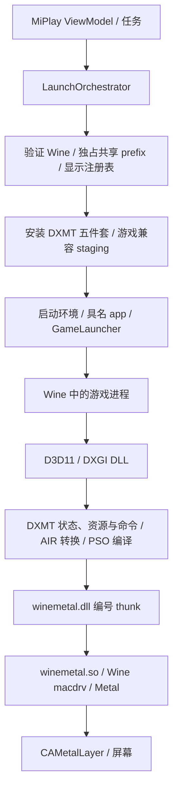

# DXMT 为 MiPlay 定制的代码调研与实施建议

调研日期：2026-10-09。本文为分析与方案，不包含运行时代码修改。

## 1. 调研依据与结论边界

- DXMT fork：`e94c312f5c054263acf261cfa109edf13e757587`，提交日期 2026-10-06。
- MiPlay：本地 `/Users/stevetan/SteveTan/Document/Xcode/MiPlay`，origin 为 `SteveTanSaMa/MiPlay`，HEAD 为 `00f97b3b9f3512e57bb3ead7c69a6b3c9c608c57`。分析包含当前未提交文件；没有修改该仓库。
- MiPlay 随包资产：五个 DXMT 文件；四个 PE DLL 为 x86-64，`winemetal.so` 为 x86_64 Mach-O；`d3d11.dll` 包含 `v0.80` 版本字符串。这支持文档中的 v0.80 记录，但不等同于已验证全部二进制与官方发布包逐字节一致。
- 拉取上游 `v0.80` 标签作源码对照：对应提交 `589adb780354b461645b29999cefaf533594ee99`。当前 fork 与该基线之间有 262 个提交；仅 d3d11/dxmt/winemetal 三个目录就有 54 个文件变化。因此不能直接把当前 main 当作 MiPlay 现用版本的小补丁。
- 阅读范围覆盖 MiPlay 的应用组装、启动编排、Wine/prefix 管理、性能设置、进程环境、资产 staging、相关测试和历史调查；DXMT 的设备、shader/PSO 编译缓存、任务调度、命令队列、Map/回读、Present、MetalFX、对象桥接、构建与测试配置。未逐行审计全部 AIR 指令转换及游戏所有 shader。

证据分为三类：代码直接确认的行为/缺陷、历史文档报告的实测、尚需运行验证的性能或因果假设。本次没有构建 DXMT、执行 MiPlay 测试、启动游戏或测量 FPS，也没有更换运行资产。不能据此承诺性能提升比例，或宣布历史崩溃根因已经确定。

**建议先建立版本与验证基线，修复资源生命周期及错误处理，再做有测量依据的性能优化。MetalFX 和帧生成应排在基础稳定性之后。**

## 2. MiPlay 实际如何使用 DXMT

MiPlay 是 SwiftUI 应用，当前业务核心围绕原神、星穹铁道、绝区零。`MiPlayApp` 组装服务，ViewModel 发起业务操作；actor 化的 Domain 服务维护游戏状态、任务、Wine 身份和共享 prefix；Infrastructure 管理进程、文件、网络与持久化。与 DXMT 直接相关的执行边界是 `LaunchOrchestrator`，不是 SwiftUI 绘制层。

代码入口：

| 位置 | 实际职责与依赖 |
| --- | --- |
| [MiPlayApp.swift](/Users/stevetan/SteveTan/Document/Xcode/MiPlay/MiPlay/MiPlayApp.swift:113) | 组装 ProcessManager、WineRuntimeProvider、LaunchOrchestrator 等服务 |
| [LaunchOrchestrator.swift](/Users/stevetan/SteveTan/Document/Xcode/MiPlay/MiPlay/Domain/Launch/LaunchOrchestrator.swift:196) | 验证 runtime，取得共享 prefix lease，prepare prefix，定位游戏 exe，staging，再启动与确认进程；退出后清理 |
| [BuiltInWineVersions.swift](/Users/stevetan/SteveTan/Document/Xcode/MiPlay/MiPlay/Domain/Runtime/BuiltInWineVersions.swift:15) | 固定 runtime tag `wine-crossover-11.0-1-signed`，下载来源为 YAAGL Wine 发布 |
| [LaunchCompatibilityEnvironment.swift](/Users/stevetan/SteveTan/Document/Xcode/MiPlay/MiPlay/Domain/Launch/LaunchCompatibilityEnvironment.swift:143) | 将 DXMT d3d10core/d3d11/dxgi 放入 runtime 的 x86_64-windows；原文件保留 .bak，并将 .bak 放入 prefix system32；winemetal.dll 放 runtime 与 prefix，winemetal.so 放 x86_64-unix |
| [ProcessManager.swift](/Users/stevetan/SteveTan/Document/Xcode/MiPlay/MiPlay/Infrastructure/Process/ProcessManager.swift:164) | 继承宿主环境，删除继承的 MTL_/METAL_，最后合并显式覆盖；因此显式 Metal HUD 仍有效 |
| [GameLauncher.c](/Users/stevetan/SteveTan/Document/Xcode/MiPlay/Tools/GameLauncher/GameLauncher.c:25) | 具名 app 的入口，fork/exec Wine，输出日志与退出状态；编排器还有直接子进程回退路径 |
| [AppData.swift](/Users/stevetan/SteveTan/Document/Xcode/MiPlay/MiPlay/Infrastructure/Persistence/AppData.swift:311) | RetinaMode 当前是应用级可配置项，默认 y；HUD 默认关闭；fpsUnlock 尚未接入执行效果 |
| [PerformanceOptionManager.swift](/Users/stevetan/SteveTan/Document/Xcode/MiPlay/MiPlay/Domain/Performance/PerformanceOptionManager.swift:341) | MetalFX 定义、参数模板保留，但 isSuspended=true，不进入启动环境 |

其他已核实的边界：

- 原神当前经过 Steam 兼容存根启动，其他两款直接启动 exe；原神 ESYNC，其他 MSYNC。它们属于 Wine/启动兼容性，不应挪进 DXMT 的热路径。
- 游戏自带 Vulkan loader 会在启动期间移开，退出后恢复。DXMT 只承担 D3D 到 Metal 的转换，不能保证驱动/启动存根兼容性。
- MiPlay 当前生产启动代码未发现 LSFG/Lossless Scaling 接入调用；References 和历史笔记不能作为已经接入的证据。
- 共享 prefix lease 与 wineserver 清理已有明确边界；不建议为试验绕过 lease，或在游戏运行中替换 DLL。
- MiPlay 最低系统校验为 macOS 26+；DXMT 文档面向 Sonoma+，并有非 Apple GPU 实验支持。fork 的产品验证优先覆盖 MiPlay 支持范围，同时尽量不破坏上游其他路径。

**集成关系是二进制安装 + Wine ABI + 启动配置，MiPlay 没有直接调用 DXMT 的 C++ API。** 大部分深度集成首先需要可追溯的发布包、明确配置语义和可靠诊断，并不需要引入每帧跨进程 RPC。

## 3. DXMT 核心架构与性能路径

1. `src/dxgi` 建立 Factory/Adapter/Output 和设备视图，读取配置、呈现显示信息。`src/d3d11` 实现 D3D11 设备、上下文、状态、资源、shader 和 swapchain；`src/d3d10` 复用 D3D11 实现。
2. shader 的 DXBC 经 `src/airconv`（LLVM 15）转换为 AIR/Metal library；`PipelineCache` 缓存 shader variant 和各类 PSO，任务调度器在后台编译。
3. Draw/Dispatch 的状态归并与命令建立在 D3D 上下文执行；真正编码通过 command chunk 交给后台线程。`FinalizeCurrentComputePipeline` 的命令在编码时调用 `GetPipeline`，该调用可能等待异步编译。
4. `CommandQueue` 使用 32 个 chunk、编码线程和完成线程；完成后回收分配、推进 CPU/GPU fence。动态资源通过 rename/recycle 降低同步；staging Map 遇到 GPU 未完成时可能 flush 并等待。
5. Present 经过 swapchain、帧延迟边界与 Presenter；后者申请 drawable，执行显示转换并提交。MetalFX spatial 位于 Present 前，输入仍是游戏交换链。
6. Wine 构建通过 PE `winemetal.dll` 的编号 Unix call 到 Objective-C `winemetal.so`，并依赖 Wine 的私有 macdrv 符号/结构。PE/Unix bridge 必须作为一个配套版本交付。

关键位置：[计算管线等待](/Users/stevetan/SteveTan/Document/Developer/Forks/DXMT/src/d3d11/d3d11_context_impl.cpp:4979)、[异步队列](/Users/stevetan/SteveTan/Document/Developer/Forks/DXMT/src/dxmt/dxmt_command_queue.cpp:99)、[staging Map 等待](/Users/stevetan/SteveTan/Document/Developer/Forks/DXMT/src/d3d11/d3d11_context_imm.cpp:234)、[Present](/Users/stevetan/SteveTan/Document/Developer/Forks/DXMT/src/d3d11/d3d11_swapchain.cpp:739)、[Wine 私有桥接](/Users/stevetan/SteveTan/Document/Developer/Forks/DXMT/src/winemetal/unix/winemetal_unix.c:1685)。

这些是潜在瓶颈位置，不代表已经测得 MiPlay 的瓶颈。先区分 shader 首次编译、CPU 命令编码、GPU 执行、回读同步、显示等待，才能避免优化错层。

## 4. 优先级与预期价值

成本为相对工作量，风险指实现与部署影响；性能收益尚未测量。

| 顺序 | 建议 | MiPlay 价值 | 成本 | 风险 | 优先级 |
| --- | --- | --- | --- | --- | --- |
| 1 | 固定稳定基线、可追溯发布包和 Wine 配套验证 | 避免把未经验证的 main 整体替换现用稳定资产；便于回滚/二分 | 小至中 | 低 | P0 |
| 2 | 修复编译任务销毁顺序 | 防止退出/设备重建时访问已销毁任务 | 小 | 中 | P0 |
| 3 | 修复桥接错误所有权、引用赋值和编译失败资源释放 | 降低错误恢复导致的二次崩溃与泄漏 | 中，分小补丁 | 中 | P0 |
| 4 | 配套改进 MiPlay 资产验证与安装事务 | 防止混版、部分安装、静默回退 | 中，需 MiPlay 授权 | 中 | P0 |
| 5 | 补齐低开销指标，复现绝区零历史回归 | 把调优与崩溃定位变成可比较证据 | 中 | 低至中 | P1 |
| 6 | 按测量优化编译并发、缓存访问和写入 | 缩短首次进入/切场景卡顿，减少 CPU/IO 竞争 | 中 | 中 | P1，条件性 |
| 7 | 帧节奏、显示切换与 drawable 异常处理 | 改善卡帧、切屏/最小化稳定性和延迟 | 中 | 中 | P1/P2 |
| 8 | MetalFX 按实际输出尺寸适配 | GPU 受限时降低渲染像素并避免过大画布 | 中至大 | 中至高 | P2 |
| 9 | 验证共享资源用于未来帧生成/采集 | 为后续功能保留低拷贝通路 | 大 | 高 | P3 |

## 5. 建议细节：稳定性与交付

### 5.1 先建立 MiPlay 专用发布契约

现状：当前 CI x86_64 构建使用 Wine `v8.16-3shain`，MiPlay 使用固定 Crossover Wine tag。现有跨版本成功经验不能证明 fork main 与该 runtime 的所有私有接口兼容。

位置：[CI 构建](/Users/stevetan/SteveTan/Document/Developer/Forks/DXMT/.github/workflows/ci.yml:20)、[Unix 链接](/Users/stevetan/SteveTan/Document/Developer/Forks/DXMT/src/winemetal/unix/meson.build:6)、[版本生成](/Users/stevetan/SteveTan/Document/Developer/Forks/DXMT/meson.build:142)。

建议保留上游 CI，在额外 MiPlay 构建/验证 job 中产出完整五件套及 manifest：上游提交、fork 提交、dirty 状态、架构、Wine 构建身份、编译选项、AIR/cache 版本、逐文件 SHA-256。manifest 先承担发布完整性验证；桥接运行期版本握手只在确有混版需求时扩展，避免立即改变 ABI。

保留现有 v0.80 资产作为对照，优先在隔离 runtime/prefix 验证 fork；不要直接修改用户当前 runtime。发布只选择已验证提交，不以“最新 main”作为质量判定。第一阶段无需 MiPlay 代码改变；正式消费 manifest/选择版本需要配套修改。

### 5.2 编译任务必须先停止，再销毁任务对象

代码确认：[PipelineCache 成员](/Users/stevetan/SteveTan/Document/Developer/Forks/DXMT/src/d3d11/d3d11_pipeline_cache.cpp:191) 将 scheduler 声明在 shader/PSO map 之前；C++ 析构成员顺序相反，map 会先销毁。调度器保存并执行任务裸指针，直到自己的析构才停止并 join 工作线程（[task_scheduler](/Users/stevetan/SteveTan/Document/Developer/Forks/DXMT/src/dxmt/dxmt_tasks.hpp:58)）。有在途编译时，存在任务释放后仍被 worker 使用的窗口。

建议最小修复优先考虑把 scheduler 的成员顺序安排为先析构、后销毁 map；若需要显式 shutdown，则保证幂等、停止提交、唤醒及 join 均在任务存活期间完成。不要通过任务强持有 D3D device 规避生命周期，容易重新引入线程与设备析构相互等待。

验证：在故意延迟的 shader/PSO 任务进行中销毁 cache/设备；重复创建释放设备，覆盖窗口重建和游戏退出；用可用的 sanitizer 或确定性阻塞测试确认 worker 不接触已释放对象，并检查是否挂死。

**该问题在 v0.80 也存在；不是较新构建回归的充分解释。MiPlay 无需配套 API 修改。**

### 5.3 修复对象所有权与编译失败清理

三个可分开的补丁：

- [WMT::Reference 赋值](/Users/stevetan/SteveTan/Document/Developer/Forks/DXMT/src/winemetal/Metal.hpp:84) 先 release 旧 handle 再 retain 新 handle。自拷贝或赋值来自相同对象的非 owning wrapper 时，如果旧引用是最后一个所有者，会在 retain 前释放对象；自移动也缺少保护。推荐先取得新引用再释放旧引用，并处理 self move。这是静态可确认的边界缺陷，但尚未发现 MiPlay 游戏路径触发它的证据。
- [newLibrary 的 NSError 返回](/Users/stevetan/SteveTan/Document/Developer/Forks/DXMT/src/winemetal/unix/winemetal_unix.c:338) 和 [compute PSO 错误返回](/Users/stevetan/SteveTan/Document/Developer/Forks/DXMT/src/winemetal/unix/winemetal_unix.c:372) 没有 retain 错误对象，而 C++ 通过 `Reference<Error>` 释放。按 Apple 的非 ARC 所有权规则，error out parameter 默认是借用引用；当前手工管理内存的实现存在契约不一致，可能在 pool drain 时重复释放。推荐明确所有 out-error 的 owning/borrowed 契约，统一在桥接处转交一个拥有的引用，并确保复用 err 时释放旧值。补 pool 前先修复此契约；graphics/compute PSO worker 当前没有局部 autorelease pool。
- [shader 编译失败](/Users/stevetan/SteveTan/Document/Developer/Forks/DXMT/src/d3d11/d3d11_shader.cpp:73) 中 `compile_result` 在 newLibrary 错误时提前 return，越过 `SM50DestroyBitcode`；推荐用已有风格的作用域清理。现有 ready 表示任务结束，不等同编译成功；下游已检查空 PSO，应保证任何失败都能终结依赖、释放资源并输出可诊断错误，不造成无限等待。

NSError 判断是源码结合 [Apple Memory Management Policy](https://developer.apple.com/library/archive/documentation/Cocoa/Conceptual/MemoryMgmt/Articles/mmRules.html) 的推断；需要错误注入/NSZombie 或适用的 sanitizer 验证具体运行结果。不能据此直接断言它造成了 MiPlay 历史错误对象替代 Metal device 的崩溃。

验证覆盖相同 handle 赋值、自移动、library/PSO 创建失败、损坏缓存后的重新编译、autorelease pool drain 和重复重试。这些补丁无需 MiPlay 接口修改，但影响所有 Metal 对象，应分批提交和验证。

### 5.4 MiPlay staging 的配套建议（仅建议，未修改）

代码确认的风险：

- [资产来源选择](/Users/stevetan/SteveTan/Document/Xcode/MiPlay/MiPlay/Domain/Launch/LaunchCompatibilityEnvironment.swift:113) 仅检查 d3d11.dll 存在，不能证明五件套完整。
- [copyOutcome](/Users/stevetan/SteveTan/Document/Xcode/MiPlay/MiPlay/Domain/Launch/LaunchCompatibilityEnvironment.swift:478) 删除目标后再复制；复制失败时原目标已丢失，而且错误被归为 sourceMissing。
- stage 按文件逐一执行；缺失资产后 [编排器](/Users/stevetan/SteveTan/Document/Xcode/MiPlay/MiPlay/Domain/Launch/LaunchOrchestrator.swift:225) 记录 warning 并继续启动。部分成功可能留下版本不配套的 frontend/bridge。
- 大小 + 小于 1 秒的 mtime 差作为身份判断，可能漏检同大小/时间接近的替换；已有测试主要覆盖正常幂等拷贝及改变大小，不能保证同大小内容修改或中断安装的正确性。

建议：只在已验证且完整的 package 上安装；先写临时文件并校验，再在所有 Wine 进程退出且 lease 生效时替换；跨文件操作需要提交记录与失败回滚，单文件 rename 不保证整个包原子。必需渲染组件缺失/安装失败应返回可操作错误并阻止此次启动；可选资产单独处理。hash 在安装/变更时计算，并缓存已验证包身份，避免每次启动全量读几十 MB。跟随 Wine 更新刷新 .bak 的身份，避免无意保留其他 Wine 版本的原始 DLL。

已有 prefix 原始 frontend / runtime DXMT frontend 分工由测试明确确认，应保留，除非先证明新的安装布局在该 Wine loader 下等价。不要未经验证改成“所有 DLL 都直接覆盖 system32”。

补充：MiPlay 支持选择包含游戏子目录的安装根目录，但 staging 的 driver/Vulkan 路径以选中目录为根，可能与已经解析的 exe 目录不一致。建议用 resolved executable 的父目录核实每游戏的数据路径；原神国际服路径需单独验证。此项属于 MiPlay 启动边界修复，不能通过 DXMT 代码解决。

验证包含缺一个桥接文件、同大小内容改变、复制失败、安装中断、旧 runtime 更新、无 App Support 的首次安装、游戏子目录选择，以及退出后兼容文件恢复。

## 6. 建议细节：性能、呈现和功能

### 6.1 用现有指标建立测量，定位历史回归

MiPlay 历史实施记录报告：`654f547` 构建绝区零概率崩溃，错误涉及对非 Metal 对象发送 compute PSO 创建消息；改用 v0.80 后多次短测存活。此证据支持优先调查版本回归，但短时存活不证明长期稳定，本次也未检查对应完整 crash dump。

建议对照 v0.80、历史候选、当前 fork；固定同一个 Wine、配置、分辨率与操作路径，先复现，再对成功/失败构建二分。分别确认 crash message 的 receiver 来自 device 还是 descriptor/其他对象，记录编译任务、device 创建/销毁、桥接版本与错误返回。旧缺陷修复与回归二分分别处理，不把同时发现的缺陷都归因于同一崩溃。

DXMT 已有 [FrameStatistics](/Users/stevetan/SteveTan/Document/Developer/Forks/DXMT/src/dxmt/dxmt_statistics.hpp:1) 及 HUD：命令数、同步次数/时间、编码时间、drawable 阻塞、present latency。建议增加 shader/PSO cache 命中、编译耗时与等待耗时，按短时间窗口聚合，仅 opt-in 输出；利用现有 GPU timestamp bridge补测量。帧时间需记录足够样本才能算 p95/p99，不能用目前 16 帧均值代替分位数。

这些数据覆盖“平均 FPS 尚可但周期卡顿”的体验；不建议每 Draw 写日志、每帧 flush 文件或添加通用实时监控服务。MiPlay 第一阶段可以用单独诊断运行读取输出，正式日志关联可在 LaunchOrchestrator 记录 package ID、有效配置、cache path 与 launch operation ID。

### 6.2 编译并发和缓存：有证据后优化

位置：[编译线程策略](/Users/stevetan/SteveTan/Document/Developer/Forks/DXMT/src/dxmt/dxmt_tasks.hpp:48)、[shader 缓存](/Users/stevetan/SteveTan/Document/Developer/Forks/DXMT/src/dxmt/dxmt_shader_cache.cpp:21)、[SQLite cache](/Users/stevetan/SteveTan/Document/Developer/Forks/DXMT/src/winemetal/unix/cache.c:102)。

当前 worker 从 2 个增长，上限 hardware_concurrency × 2，优先级 TIME_CRITICAL；Metal 侧也启用最大并发编译。外层任务和底层编译并发可能竞争游戏 CPU 与 MiPlay 后台任务，但没有证据证明“减少/增加线程”必然更快。先测冷启动、首次地图/技能、新场景与暖缓存的编译等待及 CPU 利用，再试有上限的可选 worker 配置；保留默认兼容行为。

AIR cache 已有 shader hash、variant flags、Metal 版本及 AIRCONV 版本区分；不要无理由重写缓存，也不能承诺它消除 Metal PSO 编译。SQLite 每个 set 单独执行，writer 有全局锁；若证据显示缓存写入拖慢编译，可试受限批量事务/短队列，失败只丢缓存且回退即时编译，不阻塞游戏。启动 flock 是阻塞式，建议缓存不可用时及时退回无缓存，并做并发/损坏/只读目录验证。

MiPlay 配套只需为每游戏/经兼容性验证的 cache schema 指定绝对 `DXMT_SHADER_CACHE_PATH`，并记录命中数据；无需改公共 D3D ABI。默认按 exe 已经区分三款游戏，不必为每次启动创建新 cache。只有影响生成代码但没有进入 cache key/schema 的定制才需要隔离或提升版本；盲目每提交清缓存会损失暖缓存收益。

### 6.3 帧节奏、显示变化与异常返回

位置：[Present1 节流](/Users/stevetan/SteveTan/Document/Developer/Forks/DXMT/src/d3d11/d3d11_swapchain.cpp:739)、[Presenter 获取 drawable](/Users/stevetan/SteveTan/Document/Developer/Forks/DXMT/src/dxmt/dxmt_presenter.cpp:154)。

`preferredMaxFrameRate` 为 Metal 侧约束，不会解除游戏引擎帧率上限；MiPlay 的 fpsUnlock 当前也没有实际下发。不能将这两个功能混为一个开关。先核实 SyncInterval 与 preferred rate 的组合：当前公式 SyncInterval 大于 1 时会继续按倍数增加间隔，不应随意改掉游戏请求的同步语义。

跨显示器、刷新率变化、窗口/全屏切换应测试有效刷新率更新；Presenter 使用 nextDrawable 后没有显式空 drawable 分支，建议研究申请失败时的跳过呈现及 fence/信号量收敛，避免黑屏后一直等待。任何错误处理都必须保持 frame counters、同步状态和资源回收一致。若要暴露低延迟模式，先测默认 3 帧队列与较低延迟对 GPU 吞吐/输入延迟的影响，不全局强制 1 帧。

MiPlay 配套：以后把“限制帧率”作为明确配置，合并 DXMT_CONFIG 为一个键值配置再序列化。现在 PerformanceOption.launchEnvironment 按环境键覆盖，未来多个选项都写 DXMT_CONFIG 会覆盖整串；当前只有一个暂停的相关选项，尚不是活跃回归。

### 6.4 MetalFX：先解决输入和输出尺寸的关系

代码确认：[scale_factor](/Users/stevetan/SteveTan/Document/Developer/Forks/DXMT/src/d3d11/d3d11_swapchain.cpp:143) 只设下限 1；[ResizeBuffers](/Users/stevetan/SteveTan/Document/Developer/Forks/DXMT/src/d3d11/d3d11_swapchain.cpp:518) 为交换链尺寸 × factor 创建输出纹理；[Presenter](/Users/stevetan/SteveTan/Document/Developer/Forks/DXMT/src/dxmt/dxmt_presenter.cpp:21) 调整图层 contents scale。此路径不会主动减小游戏渲染分辨率。MiPlay 目前暂停该功能是有源码依据的。

推荐两步：

1. 先做小范围鲁棒性修复：验证 factor 为有限数且符合文档范围，校验输出尺寸/设备限制；处理 scaler 创建失败；目前断言检查的是 SpatialScaler wrapper，而不等同其内部 Metal scaler 成功。明确不支持设备与创建失败的回退结果，并覆盖零尺寸/最小化、MSAA 与格式路径。
2. 再设计可选“按窗口实际 backing 像素输出”模式，保留旧 factor 语义为默认。通过 Wine/macdrv 或受限桥接查询正确输出尺寸，在游戏确实以低分辨率创建交换链时放大，避免原生画布继续乘 2。外接非 Retina 屏、跨屏和全屏要更新目标尺寸。

MiPlay 需授权修改 PerformanceOptionManager、WineRuntimeProvider 的显示策略及启动顺序：性能模式在 prepare prefix 前确定；按此次启动选择 Retina 或配合游戏内分辨率，退出/下次启动恢复期望设置。`RetinaMode=n + factor=2` 只可作为特定 Retina/Wine 场景的待验证方案，不能当作所有屏幕的普遍正确设置。当前 Retina 是应用级用户设置，不应被功能永久改写。

预期价值只成立于 GPU 受像素量限制且画质可接受的场景。需比较源渲染尺寸、最终 drawable、GPU 时间、p95/p99、文字/UI、HDR；CPU 或编译受限时不能保证提高帧率。Temporal MetalFX/DLSS 路径另需运动矢量/深度等，不是换一个选项即可获得。

### 6.5 长期方向：共享资源与自动化回归资产

当前 fork 已有共享纹理/NT handle/Mach port、keyed mutex 与 shared fence 支持（[设备入口](/Users/stevetan/SteveTan/Document/Developer/Forks/DXMT/src/d3d11/d3d11_device.cpp:775)、[资源导入导出](/Users/stevetan/SteveTan/Document/Developer/Forks/DXMT/src/d3d11/d3d11_texture_device.cpp:393)）。若 MiPlay 后续真正接入 LSFG 或采集，先用实际生产者/消费者验证现有路径，再决定是否增加零拷贝输出接口。只有 capture 的瓶颈被确认，才值得将 Present 输出与后处理直接协同。

这类集成需要独立设计进程间句柄权限、格式/HDR、同步、资源寿命、resize/device lost 和失败回退；当前不应直接 hook Present。ARM64EC 同样属于未来 Wine/runtime/bridge 联动迁移，不能靠把当前 x86_64 发布包替换成 arm64 解决。

比大规模重构更值得长期投入的是可重放的小型 shader/PSO 与资源操作回归样本：从真实故障提炼不含游戏专有资产的最小复现，使上游同步后可以自动检测兼容性，而不用每次完全依赖人工游戏观察。

## 7. 验证门槛与实施顺序

现有 DXMT `tests/dx11/meson.build` 创建 cube、triangle、lighting、HDR 示例，没有注册自动化 `test()`；上游 CI 核心为构建与打包，不能当作 MiPlay 游戏行为已通过。MiPlay 已有 staging 幂等、资产优先级、环境过滤和性能配置测试，但多为 stub 文件，不验证真实 Wine loader 或 Metal。

建议顺序：

1. 固定并记录 v0.80 实际资产哈希、Wine 身份、设备与配置，建立隔离验证位置；产出 fork 完整 package manifest。正式 runtime 保持现有资产。
2. 分别实施 task 生命周期、Reference/NSError 契约、shader 失败清理，每项一个小提交并附针对性测试；不夹带性能调参。
3. 授权后在 MiPlay 实施 staging 完整性、失败分型与事务回滚，并将 package 身份关联日志。
4. 基线 + 候选版本重复运行三款游戏，绝区零重点二分历史回归；补充聚合指标，找出可优化部分。
5. 仅对测得热点实施缓存或 worker 调优，然后评估帧节奏/显示异常。
6. 最后以独立实验开关开展 MetalFX；帧生成/ARM64EC 另开设计阶段。

运行验证建议：

| 场景 | 需要观察 |
| --- | --- |
| 三款游戏冷/暖缓存启动与固定场景 | 启动耗时、帧时间分位数、编译等待、CPU/GPU 时间、峰值内存，重复多次并报告离散程度 |
| 绝区零重点稳定性 | 首次编译、切场景、至少一段 30–60 分钟会话，再逐步延长；记录崩溃/黑屏/退出等待，不把短测存活作为结论 |
| 窗口/全屏/最小化/切屏/睡眠恢复 | drawable、刷新率、Retina/HDR、frame fence 和信号量收敛 |
| 快速启动/取消/退出/重复创建设备 | 在途任务、共享 prefix lease、wineserver、驱动/Vulkan 文件恢复 |
| 失败注入 | 不完整/混版包、不可写目标、损坏/锁住缓存、library/PSO 失败、scaler 失败 |
| 构建与同步 | MiPlay x86_64 builtin 包及配套 Wine 验证；保留上游构建矩阵和主要接口 |

性能测试与 Metal validation 分开运行，MiPlay 现有宿主 Metal 变量过滤机制应保留；诊断运行通过明确的测试入口显式注入所需变量，不能为了开启校验让正常启动普遍继承 Xcode 调试环境。

每批补丁先过针对性测试与短场景，再过游戏稳定性验证；只有达到预定功能与性能门槛才替换 MiPlay 随包资产。出现回归可整体回滚 package，不能只回滚一个 DLL。

## 8. 保持上游可追溯与降低维护成本

- 保持上游来源提交可定位；记录已验证 release 与 patch 列表。此次尚未新增 upstream remote，也没有修改分支历史或推送。
- 生命周期/错误处理采用通用、小范围实现；MiPlay 特定发布 job/manifest 独立放置，避免在 Draw/Dispatch 热路径判断 MiPlay 身份。
- 复用已有配置和统计接口；定制选项默认关闭，旧配置语义保留。优先不改变公共 D3D COM ABI。
- 同步上游分批处理，以实际验证基线为准；不要因为 fork 独立就删除其他游戏 profile、D3D10 或架构分支。
- 本轮只新增本分析文档；AGENTS.md 的修改来自之前用户授权。没有修改 DXMT 实现、MiPlay、运行资产，也没有提交或推送。
